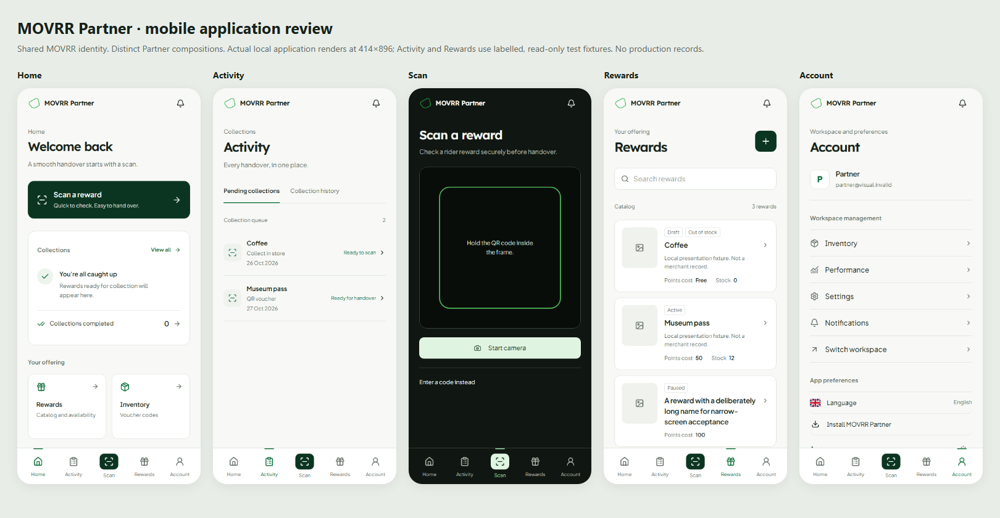

# MOVRR Partner mobile — distinct application design

27 October 2026. **Local review candidate; not pushed or deployed.**
Baseline: `e4c0ab9cc8d9ca70e36d40171de6fb22bab1178d`.
This replaces that candidate's mobile presentation. Product design acceptance is
still a visual review, separate from automated source verification.

These are actual local Next.js screens at 414×896. Home, Scan and Account use the
isolated empty-read boundary. Activity and Rewards use labelled local fixtures,
not merchant records. No production identity or data was copied into the harness.
Product images come from the existing authorized catalog at runtime; test fixtures
use the honest missing-image treatment.

## Mobbin research and implementation trace

Each category below was opened and its public screenshot examples were visually
inspected. This is per-screen research, not a claim that private app flows behind
Mobbin login were accessed. No third-party interface artwork ships in the app.

| Partner screen | Public references inspected | Observed pattern | Applied to Partner |
| --- | --- | --- | --- |
| Home | [Dashboard gallery](https://mobbin.com/explore/mobile/screens/dashboard): Apple Wallet, Revolut Business | Clear section hierarchy, concise summaries and adjacent actions | Welcome and scan action first; compact collection section; quiet empty state; offering shortcuts. No large operational score or Rider progress hero. |
| Activity | [Order history](https://mobbin.com/explore/mobile/screens/order-history): On, Shake Shack, Walmart | Scannable entries with status, dates, secondary information and a clear detail destination | Pending/history navigation, status-and-date rows and canonical collection detail links. Backend ordering and states are preserved. |
| Scan | [Camera and scanner](https://mobbin.com/explore/mobile/screens/camera-scanner): Trust Wallet, Plata Card, Walmart; [scanning flows](https://mobbin.com/explore/mobile/flows/scanning) | Unobstructed dark camera space, corner frame, short guidance and manual fallback | Dedicated dark capture composition, corner guides and manual entry. The existing camera start, validation, review and physical handover sequence remains authoritative. |
| Rewards | [Stacked lists](https://mobbin.com/explore/mobile/ui-elements/stacked-list) and [storefronts](https://mobbin.com/explore/mobile/screens/shop-storefront): Turo, Plata Card, On | Thumbnail/title/metadata hierarchy, easy item selection and catalog search | Searchable reward cards with real stock, points and state. Whole-card editor targets for managers; read-only presentation for viewers. No invented product photographs or catalog entries. |
| Account | [Settings and preferences](https://mobbin.com/explore/mobile/screens/settings-preferences): Nextdoor, Plata Card, Ubank Money App | Settings grouped by purpose, clear row destinations, current preference values and sheets | Separate identity, authorized workspace management and app preferences. Language remains in Account with a dismissible bottom sheet. |

The supporting inventory, staff, settings, notifications, reward editor and
collection detail screens use the same mobile field sizing, compact card geometry,
typography and state treatment. Existing forms and business actions are preserved.
The settings/stacked-list references informed their grouping and row ergonomics.

## Distinct Partner identity

MOVRR's mark, Lexend/Jakarta fonts, green accents and light/dark vocabulary remain
shared brand assets. Partner has its own compositions and navigation treatment:

- Quiet wordmark header; no Rider profile/points chip.
- Unboxed bell icon, transparent background, no border, 44×44px touch target and
  retained keyboard focus treatment. Mobile notification preview uses a sheet.
- A welcoming Home with compact collections and offering shortcuts. The interim
  “Service desk” heading and large count were removed following user direction.
- A simple bottom bar with a restrained active marker and a clear Scan destination.
- Image-led management cards in Rewards, an in-memory search and an explicit
  no-results state. Search reads only the already authorized catalog.
- A task-specific camera composition; no Rider gradient/watermark card treatment.

No unsupported torch/gallery controls, promotional records, new KPIs or fictional
merchant content were added. All visible counts and status details use supplied
canonical models. Test fixtures are confined to verification tooling.

## Architecture and preserved desktop

`PartnerPresentation` selects the mobile composition using the existing viewport
hook. Collections, Rewards and Account pass their existing server-authorized reads
to separate mobile components. Their desktop JSX remains the fallback composition.
Home remains separately composed, and Scan reuses the unchanged camera/validation
component. Shared routes retain canonical guards and services.

The desktop shell, desktop stylesheet, root web layout/manifest, service worker,
authentication, financial commands, authorization services and scanner logic have
no changes in this pass. A single status-toast instance sits outside the collection
presentation switch to avoid duplicate feedback during hydration.

No Admin/Rider source, production records, permissions, migrations or deployment
configuration were modified. Shop's operating gate is untouched; no public
redemption was enabled. Existing Partner install name and corrected icon assets
from the preceding local candidate are retained.

## Verification and limits

Results are recorded in [verification.json](verification.json):

- 174 unit tests across 33 suites passed; changed-source ESLint and TypeScript pass.
- Production build passed with the existing Platform API binding. No config file
  or production environment was changed.
- Empty/read-only browser matrix: 126 checks, 66 renders across 11 destinations,
  English/Dutch and 320×740, iPhone XR 414×896, S23 Ultra 412×915.
- Populated fixture matrix: 79 checks covering long names, catalog search/clear,
  empty search results, actual status/date presentation, viewer capabilities,
  required physical handover acknowledgement and closed records with no mutation
  form. No mutation command was executed.
- Desktop Home, Scan and Rewards screenshots remain pixel-identical to the
  baseline. Desktop retains its phone handoff and no camera capture UI.
- Offline restrictions, PWA manifest, simulated standalone, browser Back, overlay
  dismissal, workspace routes, reduced motion, text scaling and keyboard handling
  remain covered. Neither browser matrix recorded runtime errors.

Passing these checks establishes source and interaction quality. It does not
establish physical-device installation/camera acceptance or user design approval.
No new deployment was performed.

## Reproduce without production access

Use `scripts/prepare-partner-mobile.mjs` with a fresh
`MOVRR_PARTNER_VISUAL_TASK` and the baseline SHA above. Prepare `before` and `after`
with `MOVRR_PARTNER_VISUAL_READ_FIXTURE` unset for the empty boundary. Prepare a
second fresh task's `after` with that variable set to
`__tests__/fixtures/partner-mobile-read-models.json` for populated reads.
The harness rejects non-GET platform commands and uses an invalid local identity.

Run the isolated Next servers on three local ports. Set
`MOVRR_PARTNER_VISUAL_BEFORE`, `MOVRR_PARTNER_VISUAL_AFTER`,
`MOVRR_PARTNER_VISUAL_POPULATED`, `MOVRR_PARTNER_VISUAL_OUT` and
`MOVRR_PLAYWRIGHT_MODULE` to the local endpoints/output and installed Playwright
module. Run `scripts/verify-partner-mobile.mjs`,
`scripts/verify-partner-mobile-operations.mjs`, and this directory's
`render-review.mjs`. The populated script refuses non-local origins. Existing
fixture directories are never overwritten. No fixtures are loaded by runtime code.
