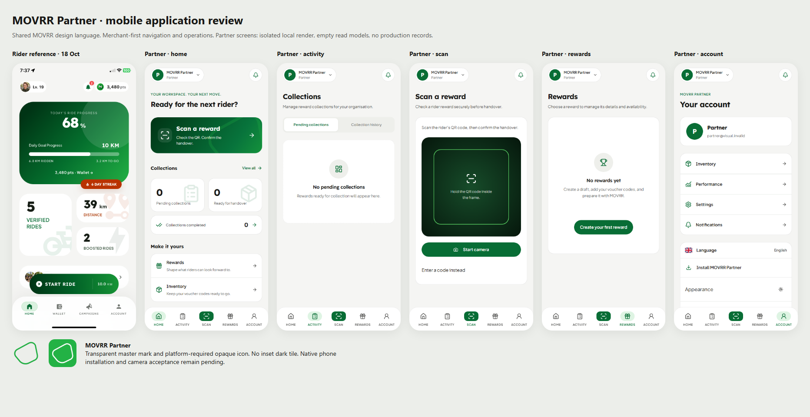
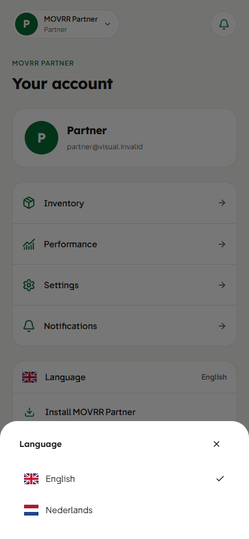

# Partner PWA presentation refinement — 27 October 2026

Visual design superseded by the [distinct Partner application review](../partner-mobile-distinct-20261027/README.md). Historical verification is retained below.
Implemented locally; **not deployed**. This supersedes the visual design of the
25 October Partner mobile candidate, not its financial or authorization model.
The comparison baseline is `0f3e1f339f6d6b439b404e6e62438c31287612fb`
(the documentation successor to deployed application `9f1660c`).

The left image is the existing Rider store-review capture from 18 October, not a
new device run. The five Partner images are actual browser renders of the local
application using the existing isolated test boundary: an invalid test identity,
empty authorized read models, and rejected mutations. They contain no production
merchant records. Rider source and assets were only read, never modified.

## Presentation

- Partner context/account chip and notification action replace the miniature
  logo/title/header toolbar. Nested screens retain a Back destination.
- Home prioritizes scanning and supplied collection counts, with compact cards
  and subtle operational icon watermarks. No invented performance metrics.
- Activity uses a full-width segmented control, collection cards and honest empty
  states. Rewards uses the existing authorized catalog with revised card geometry.
- Scan has a clear camera frame, strong camera action and manual-code fallback.
  Camera acquisition, QR decoding, token validation, retries and handover commands
  are unchanged.
- Account groups existing authorized management destinations, language, install,
  appearance, workspace switching and sign-out. Language opens a bottom sheet
  with Close, outside dismissal and browser Back support. The early browser
  installation event survives navigation from Home to Account in memory only.
- Lexend/Jakarta typography, neutral light surfaces, green dark surfaces, rounded
  cards and navigation pills follow MOVRR Rider's design language without copying
  rider progression, goals, points, training or social content.
- Mobile browser chrome follows the app's light/dark surface. Returning to the
  desktop shell restores the original theme-color metadata.

[Mobbin's public mobile gallery](https://mobbin.com/explore/mobile) was read and
visually inspected for compact context headers, focused actions, segmented lists,
and bottom-sheet patterns (including the publicly visible Nextdoor, stoic., Plata
Card and retail examples). Deeper app browsing required sign-in; no claim is made
that private Strava, Vercel, Sweatcoin or Runna flows were reviewed.

## Installation identity

The existing Partner manifest's `name` and `short_name` remain **MOVRR Partner**,
with the same `/` id, `/` scope, `/dashboard` launch and standalone display. The
signed-in Partner page serves exactly one Partner manifest and the Partner Apple
name/icon. The generic web workspace manifest and favicon assets are unchanged.

Partner-only assets now come from the existing MOVRR master symbol:

- Standard icons: large green mark on a transparent canvas, no inset dark tile.
- Android maskable icon: white mark on MOVRR bright green, inside the safe circle.
- Apple touch icon: enlarged white mark on bright green, without a nested square.

Regenerate using `node scripts/generate-partner-pwa-icons.mjs`. The copied master
source is retained at `public/pwa/partner/mark-source.png`; no Rider asset changed.

Launcher masks/backgrounds are controlled by the platform. An old installation
created against the generic web manifest may retain its old identity. After a
separately authorized deployment, inspect the existing install first; if stale,
remove that shortcut/app and install from the authenticated Partner dashboard.
Do not clear account/browser data as an icon-update workaround. Chrome documents
that manifest refresh and WebAPK updates are asynchronous:
[manifest updates](https://web.dev/articles/manifest-updates). Real-device behavior
has not been accepted in this task.

## Verification

- **171 tests / 32 suites passed**, including Partner scanning, validation,
  authorization/service contracts, locale, account boundaries, overlay history,
  PWA public-only caching and the new presentation/icon assertions.
- **Changed-source ESLint passed.** No inherited repository-wide lint investigation
  or unrelated lint cleanup was repeated.
- **TypeScript passed**, both standalone and in the final production build.
- **Production build passed**, all 37 static pages generated. The sandbox initially
  blocked existing Google font downloads; the normal network-enabled build used
  the established `PLATFORM_API_URL=https://admin.movrr.nl/api` binding. No
  environment file or production setting was changed.
- **123 browser checks / 66 mobile renders passed**: 320×740, iPhone XR 414×896,
  S23 Ultra 412×915; English/Dutch; 11 application destinations; 44px minimum tab
  targets; reduced motion; nested routes; Back; camera-denial fallback; public-only
  offline recovery; simulated standalone; text scaling; keyboard/tab handling.
- Desktop Home, Scan and Rewards screenshots are **pixel-identical** to the
  baseline at 1440×1000. Desktop scanner retains the phone QR handoff and no camera.
- Supplemental checks verify the language bottom sheet, Close and Back dismissal,
  canonical Dutch preference action, singular Partner install metadata, retained
  install capability, and mobile theme-color/desktop restoration.

The 320px sheet test found Radix's max-content minimum overflowing the viewport;
its mobile-only portal wrapper now has an explicit viewport maximum/minimum.
A client-navigation check also found Next replacing the mobile theme-color metadata; the shell now tracks head replacement and restores web metadata on exit, with a unit regression test. No browser runtime errors remain. Details: [browser-results.json](browser-results.json).

Reproduce with the existing local visual harness (no production identity): set
`MOVRR_PARTNER_VISUAL_TASK` to a fresh task directory name and
`MOVRR_PARTNER_VISUAL_BASELINE` to the baseline above, then run
`node scripts/prepare-partner-mobile.mjs before` and `after`. Run their isolated
Next servers on separate local ports, set `MOVRR_PARTNER_VISUAL_BEFORE`,
`MOVRR_PARTNER_VISUAL_AFTER`, `MOVRR_PARTNER_VISUAL_OUT`, and
`MOVRR_PLAYWRIGHT_MODULE` to the installed Playwright module, then run
`node scripts/verify-partner-mobile.mjs`. The comparison image is reproducible with
`node docs/verification/partner-pwa-refinement-20261027/render-review.mjs` using
the same output/origin/module settings and optional `MOVRR_RIDER_REFERENCE`.
Existing fixture directories are never overwritten. Browser network calls use the empty-read/rejected-command harness.

## Scope and acceptance boundary

The desktop shell, desktop stylesheet, root web layout/manifest, services,
authentication/authorization actions, scanner/financial commands and service
worker are unchanged. Shared utility controls preserve their desktop default;
new controls/styles are selected only by the dedicated mobile presentation.
Partner dashboard metadata changes only its PWA Apple installation asset.
No dependencies, Admin/Rider changes, migrations, production writes, permission
changes or deployments were made. Public Shop redemption remains Disabled;
this change does not alter its gate.

Ready for product review and subsequent controlled release. Physical iOS/Android
installation/name/icon updates, safe areas/status bars, camera permission/capture,
background/resume and keyboard acceptance remain pending on actual devices.
